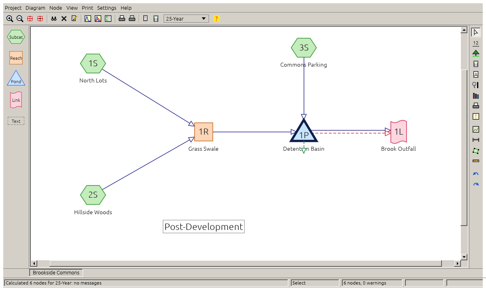
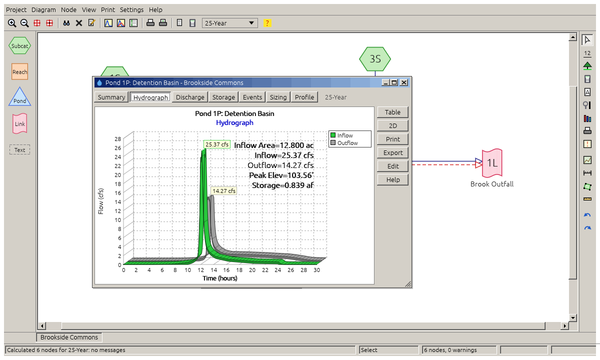
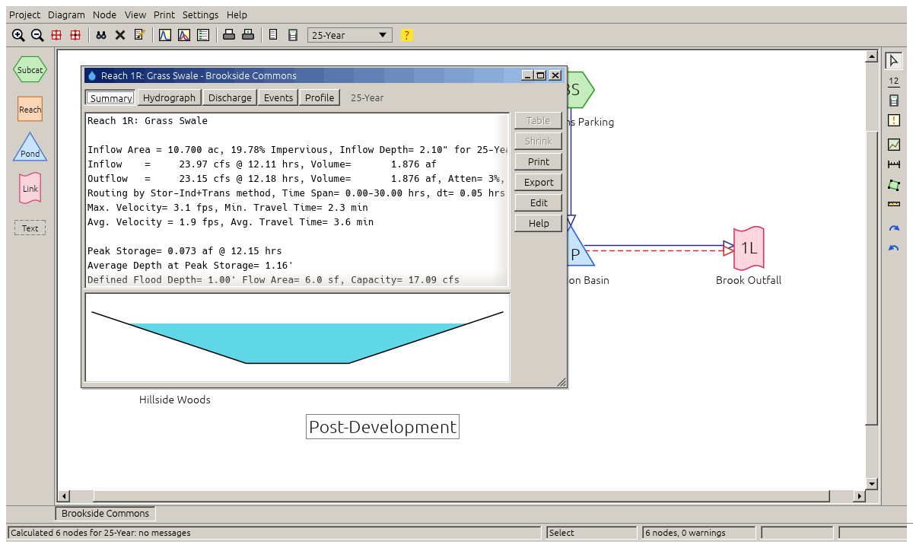
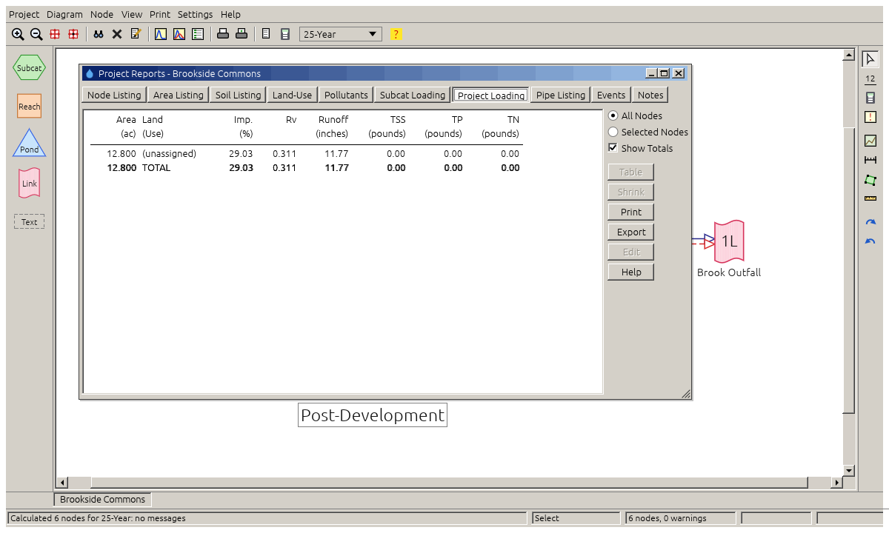
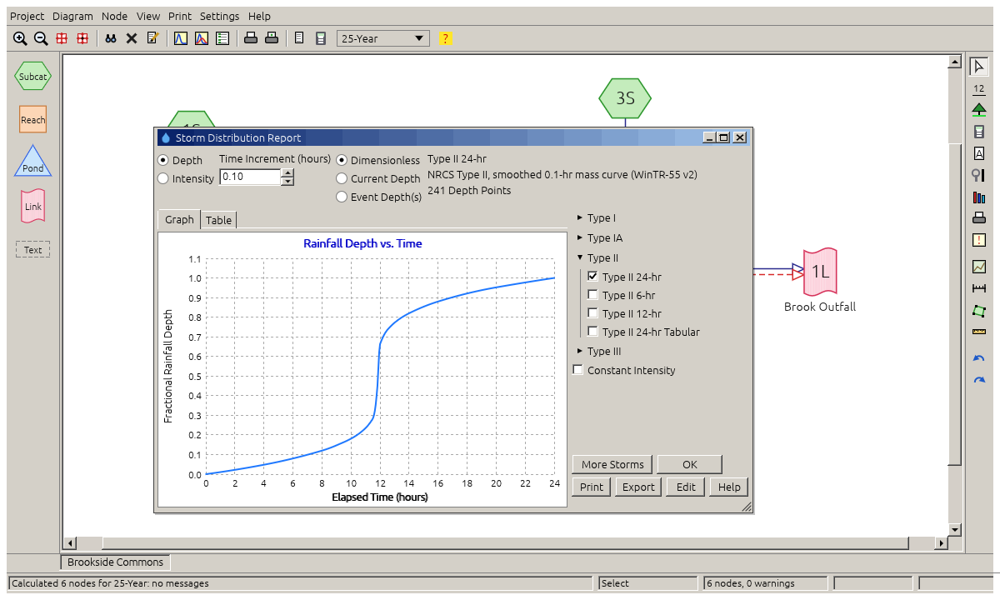
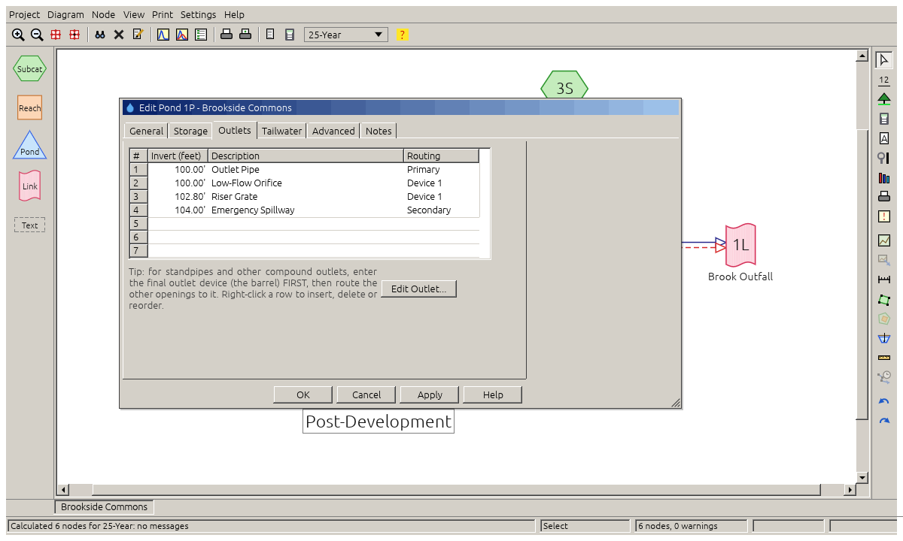
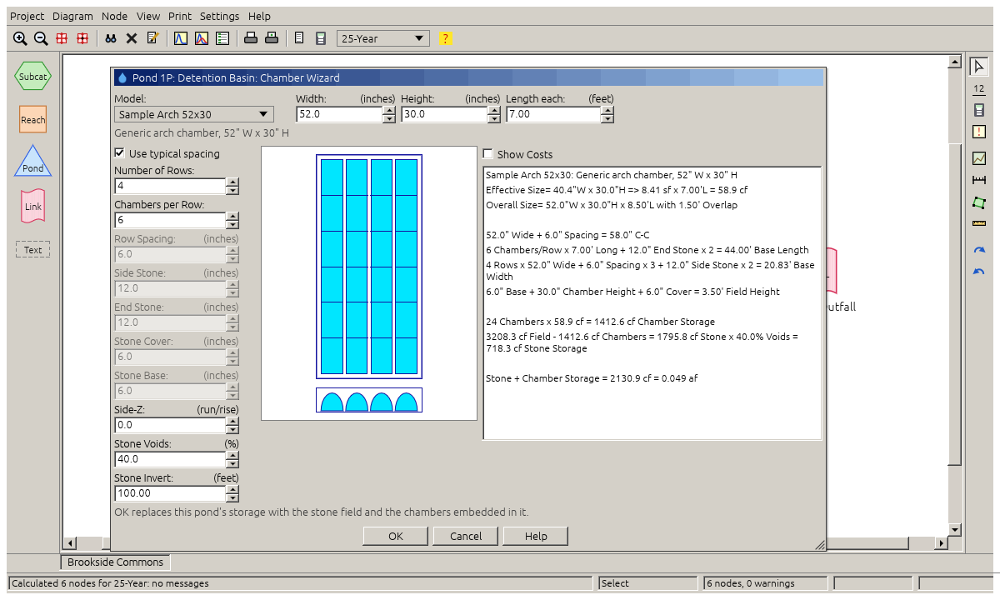

<h1></h1>

**Open-source stormwater modelling for the desktop and the browser.** Draw a routing diagram of
subcatchments, reaches, ponds and links. StormWAVES then computes NRCS (SCS) TR-55 / TR-20
runoff hydrographs and routes them through channels, pipes, detention ponds and outlet
structures. It produces the summaries, graphs and tables an engineer needs for a stormwater
report.

StormWAVES is written entirely in Rust. The same code runs natively on Linux, Windows and macOS
([egui](https://github.com/emilk/egui)/eframe) and in any modern browser (WebAssembly).



## Contents

- [Features](#features)
- [Screenshots](#screenshots)
- [Installation](#installation)
- [Usage](#usage)
- [File formats](#file-formats)
- [Methods and validation](#methods-and-validation)
- [Project layout](#project-layout)
- [Development](#development)
- [Contributing](#contributing)
- [License](#license)

## Features

**Hydrology**
- SCS/NRCS runoff with the curvilinear unit hydrograph (TR-20), SBUH, and the Rational method.
- NRCS Type I, IA, II and III storms (24-, 12- and 6-hour), custom, Chicago and back-to-back
  storms, AMC adjustment.
- Gamma unit hydrographs for any peak factor.
- Composite curve numbers from the TR-55 tables, including unconnected impervious areas.
- Time of concentration from sheet, shallow-concentrated, channel, lag/CN, Kirpich, Kerby and
  lake segments.
- TR-55 graphical peak discharge worksheet and the detention storage estimate.

**Hydraulics and routing**
- Reaches: rectangular, trapezoidal, parabolic, pipe, surveyed and rating-table sections.
  Routing by Stor-Ind, Stor-Ind+Trans, Muskingum-Cunge or Dyn-Stor-Ind.
- Ponds:
  - Storage from stage-area/stage-storage data, prismatoids, cones, pipes and arch chambers,
    with stone voids and embedded volumes.
  - A Chamber Wizard that lays out an underground chamber field.
- Outlets: culverts (inlet/outlet control), orifices and grates, broad- and sharp-crested
  weirs, custom weirs, exfiltration, pumps, siphons, delayed gates and rating tables.
  Devices can be compounded.
- Fixed, differential and dynamic tailwater.
- Calculation messages with severity levels. A pond that overtops its defined storage is
  reported as an error and its results as **undefined**, never silently extrapolated.

**Reports and output**
- Per-node Summary, Hydrograph (2-D or 3-D), Discharge, Storage, Events, Sizing and Profile
  views. Reach summaries include a cross-section drawn at the peak water level.
- Project Reports: node, area, soil, land-use, pollutant, loading and pipe listings.
- PDF printing, EMF (vector) export of graphs, summaries and the diagram, and CSV and text
  exports.
- Pollutant loading by land use (Simple Method or event runoff).

**Rainfall data**
- Rainfall Event Lookup from county rainfall tables, NOAA Atlas 14 CSV downloads and IDF files.
- A rainfall library folder of storm distribution (`.hcr`), unit hydrograph (`.huh`) and IDF
  files. Storms a project uses are copied into it, so project files stay self-contained.

**Working on the diagram**
- Drag-and-drop nodes, multiple projects in tabs, undo history, notes and pop-up field tips.
- A background image or PDF underlay with two-point scale calibration. You can trace
  subcatchment outlines on it, and the areas are measured automatically.

## Screenshots

| | |
|---|---|
|  **Pond hydrograph**: inflow and outflow in 3-D. |  **Reach summary** with the cross-section at peak depth. |
|  **Project Reports**: pollutant loading by land use. |  **Storm distributions**: the built-in NRCS curves. |
|  **Pond outlets**: the outlet device list. |  **Chamber Wizard**: underground storage layout. |

The screenshots are rendered from the built-in sample project
(`cargo run -p stormwaves-ui --example snapshot`; see [Development](#development)).

## Installation

There are no prebuilt binaries yet; build from source. It takes a few minutes.

### 1. Install Rust

Install Rust 1.95 or newer with [rustup](https://rustup.rs):

```sh
curl --proto '=https' --tlsv1.2 -sSf https://sh.rustup.rs | sh
```

On Windows, download and run `rustup-init.exe` from [rustup.rs](https://rustup.rs). It also
offers to install the Visual Studio C++ build tools that Rust needs.

### 2. Platform prerequisites

| Platform | What you need |
|---|---|
| **Linux (Debian/Ubuntu)** | `sudo apt install build-essential pkg-config libxkbcommon-dev libwayland-dev libx11-dev libxcursor-dev libxrandr-dev libxi-dev libgl1-mesa-dev`, plus a Vulkan or OpenGL driver (usually present already) |
| **Linux (Fedora)** | `sudo dnf install gcc pkgconf libxkbcommon-devel wayland-devel libX11-devel libXcursor-devel libXrandr-devel libXi-devel mesa-libGL-devel` |
| **Linux (Arch)** | `sudo pacman -S base-devel libxkbcommon wayland libx11 libxcursor libxrandr libxi mesa` |
| **macOS** | Xcode command-line tools: `xcode-select --install` |
| **Windows** | Visual Studio Build Tools with the "Desktop development with C++" workload (rustup offers it) |

### 3. Build and run the desktop app

```sh
git clone <repository-url> stormwaves
cd stormwaves
cargo run --release -p stormwaves
```

The executable is written to `target/release/stormwaves` (`stormwaves.exe` on Windows). Copy it
anywhere on your `PATH`; it needs no other files.

### 4. (Optional) Build the web version

```sh
rustup target add wasm32-unknown-unknown
cargo install trunk
cd apps/stormwaves-web
trunk serve            # development server at http://127.0.0.1:8777
trunk build --release  # static site in dist/web, ready for any web server
```

In the browser, files are opened and saved through the browser's own file pickers and
downloads. Preferences and imported rainfall files are kept in local storage.

## Usage

1. **Project > New** starts an empty project. **Project > Open Sample Project** loads a small
   worked example.
2. Drag **Subcat**, **Reach**, **Pond** and **Link** nodes from the palette onto the diagram.
   Select a node and drag its outflow arrow handle onto the node it drains to.
3. Double-click a node to describe it: areas and curve numbers, Tc segments, channel sections,
   pond storage and outlets.
4. Set the storms in **Settings > Calculation > Rainfall**. Use **Import Events From...** to
   look them up from a county table, IDF file or NOAA Atlas 14 download.
5. Results are recalculated automatically. Click a node for its report window. If a calculation
   produces hints, warnings or errors, the **Messages** window opens on its own.
6. **Print** writes PDF reports. Each report's **Export** button saves text, CSV or EMF graphics.

The built-in help (**Help > Contents**) covers the dialogs and the calculation methods.

## File formats

| Extension | Read | Write | Notes |
|---|:---:|:---:|---|
| `.waves` | ✓ | ✓ | Native StormWAVES project (JSON) |
| `.hcp` | ✓ | ✓ | Interchange project format of a widely used commercial package. Settings StormWAVES does not model are kept and written back unchanged. English-unit files only for now. |
| `.hcr` | ✓ | ✓ | Rainfall distribution |
| `.huh` | ✓ | ✓ | Dimensionless unit hydrograph |
| `*-Rain.txt` | ✓ | | County rainfall tables for Rainfall Event Lookup |
| `.idf` | ✓ | ✓ | **Provisional**: our own layout, not yet verified against real `.idf` files |
| NOAA Atlas 14 `.csv` | ✓ | | Precipitation frequency downloads for event lookup |
| TR-20 input deck | ✓ | | Legacy card-format decks (Project > Import) |
| `.csv` | ✓ | ✓ | Sub-areas, hydrographs, rating and pump tables |
| `.pdf` / `.emf` / `.txt` | | ✓ | Reports and vector graphics |

Third-party rainfall libraries and project files are loaded at runtime from files you supply.
None are bundled with StormWAVES.

## Methods and validation

The engine follows public sources:
- NRCS TR-55 and TR-20, and NEH Part 630 (unit hydrograph, Tc, curve numbers).
- WinTR-55 rainfall tables.
- FHWA HDS-5 for culverts.
- Brater & King for broad-crested weirs.
- Published handbooks for the other devices.

Every algorithm has unit tests. Golden tests reproduce published results:
- 74 published subcatchment hydrographs across NRCS storm types.
- Detention ponds over several storms.
- A public TR-20 training deck.
- The TR-55 manual's worked examples.

The calibration choices are described in [AGENTS.md](AGENTS.md#3-methods-confirmed-against-published-reference-results).

StormWAVES is engineering software provided without warranty. Check its results
independently before relying on them for design.

## Project layout

```text
crates/core            stormwaves-core: hydrology and hydraulics engine (no UI, compiles to wasm)
crates/ui              stormwaves-ui: the egui application (diagram, dialogs, reports, charts)
apps/stormwaves        desktop executable
apps/stormwaves-web    browser build (trunk)
docs/screenshots       images used in this README
```

## Development

```sh
cargo test                                               # all tests
cargo test -p stormwaves-core                            # engine tests only (fast)
cargo check -p stormwaves-core --target wasm32-unknown-unknown
cargo run -p stormwaves-ui --example snapshot -- --out shot.png --do "report:1P;tab:1"
```

The `snapshot` example renders the app headless to a PNG. It runs a small script of actions
against the sample project, such as `report:<node>`, `tab:<n>`, `edit:<node>`, `storms` or
`project-report:<n>` (see `script()` in `crates/ui/src/lib.rs`). It is how the screenshots
above were made.

Project rules for contributors and AI agents are in [AGENTS.md](AGENTS.md). In short:
- Never panic on user input.
- The core never depends on the UI.
- Every algorithm ships with tests.
- No third-party proprietary assets or data in the repository.

## Contributing

Issues and pull requests are welcome. Before submitting:
1. Run `cargo test` and the wasm check above.
2. Add or update tests for any change to calculations. Cite the public source of any
   engineering data.
3. Keep commits focused, and describe the engineering reason for a change.

To enable the repository's commit hooks, run `git config core.hooksPath .githooks`.

## License

Licensed under either of the [MIT license](https://opensource.org/licenses/MIT) or the
[Apache License, Version 2.0](https://www.apache.org/licenses/LICENSE-2.0), at your option.
