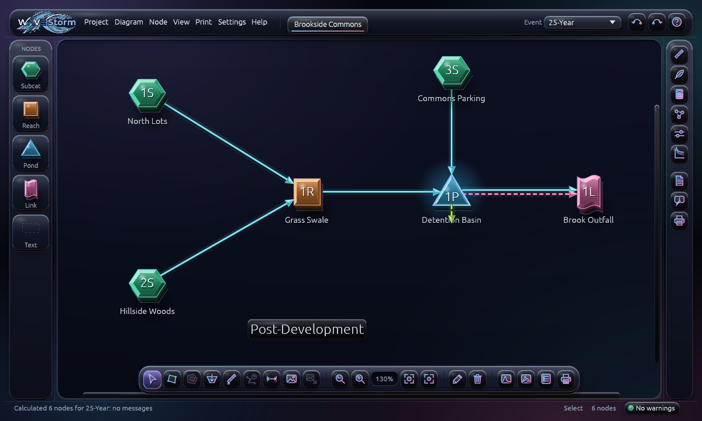
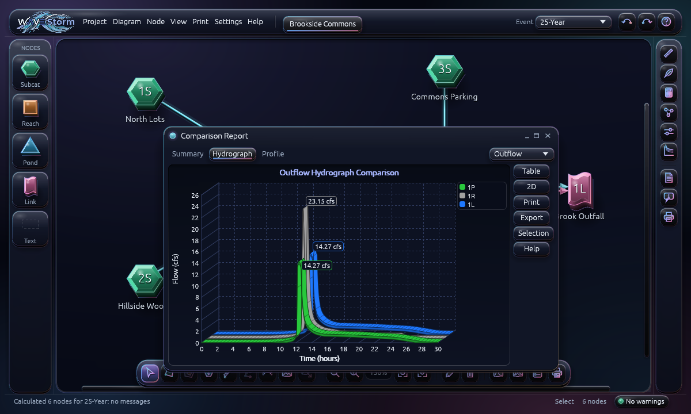

<h1><picture><source media="(prefers-color-scheme: dark)" srcset="crates/ui/assets/logo-dark.png"></picture></h1>

[](https://github.com/Coletronix/wavestorm/actions/workflows/ci.yml)
[](https://github.com/Coletronix/wavestorm/releases/latest)

**Open-source stormwater modelling for the desktop and the browser.** Draw a routing diagram of
subcatchments, reaches, ponds and links. WAVEStorm then computes NRCS (SCS) TR-55 / TR-20
runoff hydrographs and routes them through channels, pipes, detention ponds and outlet
structures. It produces the summaries, graphs and tables an engineer needs for a stormwater
report.

WAVEStorm is written entirely in Rust. The same code runs natively on Linux, Windows and macOS
([egui](https://github.com/emilk/egui)/eframe) and in any modern browser (WebAssembly).


## Contents

- [Features](#features)
- [Screenshots](#screenshots)
- [Installation](#installation)
  - [Prebuilt binaries](#prebuilt-binaries)
  - [Build from source](#build-from-source)
- [Usage](#usage)
- [File formats](#file-formats)
- [Methods and validation](#methods-and-validation)
- [Project layout](#project-layout)
- [Development](#development)
  - [Continuous integration and releases](#continuous-integration-and-releases)
- [Contributing](#contributing)
- [License](#license)

## Features

**Hydrology**
- SCS/NRCS runoff with the curvilinear unit hydrograph (TR-20), SBUH, and the Rational method.
- NRCS Type I, IA, II and III storms (24-, 12- and 6-hour), custom, Chicago and back-to-back
  storms, AMC adjustment.
- Gamma unit hydrographs for any peak factor.
- Composite curve numbers from the TR-55 tables, including unconnected impervious areas.
- Time of concentration from sheet, shallow-concentrated, channel, lag/CN, Kirpich, Kerby and
  lake segments.
- TR-55 graphical peak discharge worksheet and the detention storage estimate.

**Hydraulics and routing**
- Reaches: rectangular, trapezoidal, parabolic, pipe, surveyed and rating-table sections.
  Routing by Stor-Ind, Stor-Ind+Trans, Muskingum-Cunge or Dyn-Stor-Ind.
- Ponds:
  - Storage from stage-area/stage-storage data, prismatoids, cones, pipes and arch chambers,
    with stone voids and embedded volumes.
  - A Chamber Wizard that lays out an underground chamber field.
- Outlets: culverts (inlet/outlet control), orifices and grates, broad- and sharp-crested
  weirs, custom weirs, exfiltration, pumps, siphons, delayed gates and rating tables.
  Devices can be compounded.
- Automatic sizing of round pipe reaches and culverts to standard diameters (Settings >
  Calculation > Resize).
- Fixed, differential and dynamic tailwater.
- Calculation messages with severity levels. A pond that overtops its defined storage is
  reported as an error and its results as **undefined**, never silently extrapolated.

**Reports and output**
- Per-node Summary, Hydrograph (2-D or 3-D), Discharge, Storage, Events, Sizing and Profile
  views. Reach summaries include a cross-section drawn at the peak water level.
- Project Reports: node, area, soil, land-use, pollutant, loading and pipe listings.
- PDF printing, EMF (vector) export of graphs, summaries and the diagram, and CSV and text
  exports.
- Pollutant loading by land use (Simple Method or event runoff).

**Rainfall data**
- Rainfall Event Lookup from county rainfall tables, NOAA Atlas 14 CSV downloads and IDF files.
  NOAA for Site downloads the NOAA Atlas 14 estimates for a placed background directly
  (desktop).
- A rainfall library folder of storm distribution (`.hcr`), unit hydrograph (`.huh`) and IDF
  (`.hci`) files. Storms a project uses are copied into it, so project files stay self-contained.

**Working on the diagram**
- Drag-and-drop nodes, multiple projects in tabs, undo history, notes and pop-up field tips
  (switchable in Settings > General).
- A background image or PDF underlay with two-point scale calibration. Move and resize it
  on the diagram; your drawings follow it and keep their measured sizes.
- Trace subcatchment outlines on it, and the areas are measured automatically. Draw
  sub-areas inside an outline: each is measured and coloured, and the remainder row is
  the outline less the drawn sub-areas, so the rows always add up.
- Pond estimator: draw the top of a pond, enter its approximate depth and side slope, and a
  pond is created with its stage-area storage (prismatic) already filled in.
- Edit any drawing: drag its points, drag an edge's middle to add a point, or right-click a
  point to delete it. Areas and Tc lengths update to match.
- Draw a subcatchment's time-of-concentration flow path on the diagram. Its points are lettered
  A, B, C… and the Tc segments ("A to B", "B to D", …) are measured from it (sheet flow is
  capped at 100 ft by default); you only enter slope and surface.
- Print or export the diagram as shown on screen: background, translucent area fills, Tc
  paths and CN labels.

**Site location and soils** (United States; online only when you ask)
- Aerial Photo: find the site by address or latitude/longitude and download a NAIP aerial
  photo (or a topographic map) from USGS The National Map. It arrives placed and to scale.
- Georeference your own site plan or PDF by giving two of its points their latitude and
  longitude. This sets the scale too.
- Soils: draw an area of interest, or use the subcatchment outlines. WAVEStorm asks NRCS Soil
  Data Access (the data behind Web Soil Survey) for its soil map units and hydrologic soil
  groups, and draws them on the diagram. Dual groups count as D unless the site is drained.
- Apply the soils to subcatchments: each Area row is split by soil group, with the TR-55
  curve number of its cover for each group.
- Export the area of interest as a zipped shapefile for Web Soil Survey. Print a
  Hydrologic Soil Group report with a soil map and per-subcatchment tables.

**Projects and data exchange**
- A start page (New, Open, Open Sample Project, recent projects) when no project is open.
  Recent projects are also listed under Project > Open….
- The projects you had open come back the next time you start, including unsaved changes
  (kept in browser storage on the web) if the page or program closed before you saved or
  exported. The desktop version can also autosave projects to their files on a timer
  (Settings > General).
- Open and save `.hcp` interchange projects, import legacy TR-20 input decks, and read
  and write rainfall library files (see [File formats](#file-formats)).

**Themes** (View > Theme)
- **Classic**: the familiar engineering-software look, with bevelled grey dialogs.
- **Modern Light** and **Modern Dark**: flat versions of the same layout.
- **Iridescent Glass**: a dark theme where every surface has depth. Panels and buttons are raised
  glass slabs, fields and the diagram are sunken wells, and nodes are extruded glass blocks.
  Routing arrows and icons are lit glass tubes with iridescent rims. It uses its own
  modernised layout: a single header bar, glass rails and a floating tool dock on the diagram.

## Screenshots

| | |
|---|---|
|  **Pond hydrograph**: inflow and outflow in 3-D. |  **Reach summary** with the cross-section at peak depth. |
|  **Project Reports**: pollutant loading by land use. |  **Storm distributions**: the built-in NRCS curves. |
|  **Pond outlets**: the outlet device list. |  **Chamber Wizard**: underground storage layout. |
|  **Iridescent Glass theme**: the modernised layout. |  **Glass theme**: a comparison report. |

The screenshots are rendered from the built-in sample project
(`cargo run -p wavestorm-ui --example snapshot`; see [Development](#development)).

## Installation

### Prebuilt binaries

Download the package for your system from the
[latest release](https://github.com/Coletronix/wavestorm/releases/latest). In the file names,
`VERSION` is the release number, for example `0.7.0`.

| Platform | Download | How to use it |
|---|---|---|
| **Linux x86_64** | `WAVEStorm-VERSION-x86_64.AppImage` | `chmod +x` it and run it |
| | `wavestorm_VERSION-1_amd64.deb` | `sudo apt install ./wavestorm_VERSION-1_amd64.deb`; adds a desktop menu entry |
| | `wavestorm-VERSION-x86_64-linux.tar.gz` | The binary, licences and a `.desktop` file |
| | `wavestorm-VERSION-x86_64-linux` | The bare binary |
| **Windows x86_64** | `wavestorm-VERSION-x86_64-windows.zip` | Unzip and run `wavestorm.exe`. It is unsigned, so SmartScreen may warn: choose "More info > Run anyway". |
| **macOS** (Apple Silicon and Intel) | `WAVEStorm-VERSION-macos-universal.dmg` | Drag `WAVEStorm.app` to Applications. It is not notarised: on first launch right-click the app and choose Open, or run `xattr -dr com.apple.quarantine /Applications/WAVEStorm.app`. |

The Linux binaries need a Vulkan or OpenGL driver (usually present already) and a glibc from
roughly Ubuntu 22.04 or newer.

To verify a download, put it in the same folder as `SHA256SUMS.txt` from the release and run:

```sh
sha256sum -c SHA256SUMS.txt --ignore-missing
```

### Build from source

It takes a few minutes.

#### 1. Install Rust

Install Rust 1.95 or newer with [rustup](https://rustup.rs):

```sh
curl --proto '=https' --tlsv1.2 -sSf https://sh.rustup.rs | sh
```

On Windows, download and run `rustup-init.exe` from [rustup.rs](https://rustup.rs). It also
offers to install the Visual Studio C++ build tools that Rust needs.

#### 2. Platform prerequisites

| Platform | What you need |
|---|---|
| **Linux (Debian/Ubuntu)** | `sudo apt install build-essential pkg-config libxkbcommon-dev libwayland-dev libx11-dev libxcursor-dev libxrandr-dev libxi-dev libgl1-mesa-dev`, plus a Vulkan or OpenGL driver (usually present already) |
| **Linux (Fedora)** | `sudo dnf install gcc pkgconf libxkbcommon-devel wayland-devel libX11-devel libXcursor-devel libXrandr-devel libXi-devel mesa-libGL-devel` |
| **Linux (Arch)** | `sudo pacman -S base-devel libxkbcommon wayland libx11 libxcursor libxrandr libxi mesa` |
| **macOS** | Xcode command-line tools: `xcode-select --install` |
| **Windows** | Visual Studio Build Tools with the "Desktop development with C++" workload (rustup offers it) |

#### 3. Build and run the desktop app

```sh
git clone https://github.com/Coletronix/wavestorm.git wavestorm
cd wavestorm
cargo run --release -p wavestorm
```

The executable is written to `target/release/wavestorm` (`wavestorm.exe` on Windows). Copy it
anywhere on your `PATH`; it needs no other files.

#### 4. (Optional) Build the web version

```sh
rustup target add wasm32-unknown-unknown
cargo install trunk
cd apps/wavestorm-web
trunk serve            # development server at http://127.0.0.1:8777
trunk build --release  # static site in dist/web, ready for any web server
```

In the browser, files are opened and saved through the browser's own file pickers and
downloads. Preferences and imported rainfall files are kept in local storage.

## Usage

1. **Project > New** starts an empty project. **Project > Open Sample Project** loads a small
   worked example. With nothing open, the start page offers the same, plus recent projects.
2. Drag **Subcat**, **Reach**, **Pond** and **Link** nodes from the palette onto the diagram.
   Select a node and drag its outflow arrow handle onto the node it drains to.
3. Double-click a node to describe it: areas and curve numbers, Tc segments, channel sections,
   pond storage and outlets.
4. Set the storms in **Settings > Calculation > Rainfall**. Use **Import Events From...** to
   look them up from a county table, IDF file or NOAA Atlas 14 download.
5. Results are recalculated automatically. Click a node for its report window. If a calculation
   produces hints, warnings or errors, the **Messages** window opens on its own.
6. **Print** writes PDF reports. Each report's **Export** button saves text, CSV or EMF graphics.

The built-in help (**Help > Contents**) covers the dialogs and the calculation methods.

## File formats

| Extension | Read | Write | Notes |
|---|:---:|:---:|---|
| `.waves` | ✓ | ✓ | Native WAVEStorm project (JSON) |
| `.hcp` | ✓ | ✓ | Interchange project format of a widely used commercial package. Settings WAVEStorm does not model are kept and written back unchanged. English-unit files only for now. |
| `.hcr` | ✓ | ✓ | Rainfall distribution |
| `.huh` | ✓ | ✓ | Dimensionless unit hydrograph |
| `*-Rain.txt` | ✓ | | County rainfall tables for Rainfall Event Lookup |
| `.hci` | ✓ | ✓ | IDF curves: intensity or depth tables, coefficient equations, or a NOAA Atlas 14 CSV saved as `.hci` (current and pre-2012 layouts). Checked against published sample files. WAVEStorm's earlier `.idf` files are still read. |
| NOAA Atlas 14 `.csv` | ✓ | | Precipitation frequency downloads for event lookup |
| TR-20 input deck | ✓ | | Legacy card-format decks (Project > Import). Volumes match TR-20 output; reach-routed peaks can differ. |
| `.csv` | ✓ | ✓ | Sub-areas, hydrographs, rating and pump tables |
| `.pdf` / `.emf` / `.txt` | | ✓ | Reports and vector graphics |
| `.zip` (shapefile) | | ✓ | Area of interest for Web Soil Survey's Import AOI (WGS 84 polygon) |

Third-party rainfall libraries and project files are loaded at runtime from files you supply.
None are bundled with WAVEStorm.

## Methods and validation

The engine follows public sources:
- NRCS TR-55 and TR-20, and NEH Part 630 (unit hydrograph, Tc, curve numbers).
- WinTR-55 rainfall tables.
- FHWA HDS-5 for culverts.
- Brater & King for broad-crested weirs.
- Published handbooks for the other devices.

Every algorithm has unit tests. Golden tests reproduce published results:
- 74 published subcatchment hydrographs across NRCS storm types.
- Detention ponds over several storms.
- A public TR-20 training deck.
- The TR-55 manual's worked examples.

Key calibration choices, each covered by tests:
- Runoff uses the NRCS curvilinear unit hydrograph with a unit duration of 0.133 Tc. Peaks
  are delayed by about 0.09 Tc, which was fitted to published results. Against 18 published
  subcatchments, volumes are exact and peaks agree within about 1.5 %.
- Tc is the sum of segment times, each rounded to 0.1 min as printed in reports.
- Hydrograph peaks are interpolated with a parabola through the three highest samples.
- Culvert flow is the lesser of barrel flow (with entrance and friction losses) and inlet
  control; compound outlets pass the lesser of their feeders and their own capacity.
- Stor-Ind+Trans reaches are level-pool routed, then translated by length over the maximum
  velocity.

Known limitations: there is no rock-fill outlet yet, metric `.hcp` files are not read, and
Stor-Ind+Trans attenuation differed from the reference application by about 2 % against 4 %
on one published example.

WAVEStorm is engineering software provided without warranty. Check its results
independently before relying on them for design.

## Project layout

```text
crates/core            wavestorm-core: hydrology and hydraulics engine (no UI, compiles to wasm)
crates/ui              wavestorm-ui: the egui application (diagram, dialogs, reports, charts)
apps/wavestorm        desktop executable
apps/wavestorm-web    browser build (trunk)
docs/screenshots       images used in this README
```

## Development

```sh
cargo test                                               # all tests
cargo test -p wavestorm-core                            # engine tests only (fast)
cargo check -p wavestorm-core --target wasm32-unknown-unknown
cargo run -p wavestorm-ui --example snapshot -- --out shot.png --do "report:1P;tab:1"
```

The `snapshot` example renders the app headless to a PNG. It runs a small script of actions
against the sample project, such as `report:<node>`, `tab:<n>`, `edit:<node>`, `storms` or
`project-report:<n>` (see `script()` in `crates/ui/src/lib.rs`). It is how the screenshots
above were made.

### Continuous integration and releases

Every push and pull request runs CI: `cargo fmt --check`, clippy, the tests on Linux, Windows and macOS, the wasm
checks of the core and the web app, and a dependency licence check (`cargo deny`, configured
in `deny.toml` to allow permissive licences only).

Releases are cut by pushing an annotated tag `vX.Y.Z` whose version matches `version` in the
workspace `Cargo.toml`. The release workflow builds all the packages and publishes a GitHub
Release, with notes generated from the git history (`git log`) since the previous tag. There
is no changelog file: see the [Releases](https://github.com/Coletronix/wavestorm/releases)
page and the git history.

## Contributing

Issues and pull requests are welcome. The ground rules:
- Never panic on user input or file data. Invalid input must produce a calculation message,
  not a crash.
- The core crate never depends on the UI and must compile for `wasm32-unknown-unknown`.
- Every algorithm ships with tests; reproduce published results where they exist.
- No third-party proprietary assets or data in the repository. Draw UI art in code, and
  cite the public source of any engineering data.

Before submitting:
1. Run `cargo fmt`, `cargo test` and the wasm check above.
2. Add or update tests for any change to calculations.
3. Keep commits focused, and describe the engineering reason for a change.

To enable the repository's commit hooks, run `git config core.hooksPath .githooks`.

## License

Licensed under either of the [MIT license](LICENSE-MIT) or the
[Apache License, Version 2.0](LICENSE-APACHE), at your option.

Unless you explicitly state otherwise, any contribution intentionally submitted for inclusion
in this work by you, as defined in the Apache-2.0 license, shall be dual licensed as above,
without any additional terms or conditions.

Third-party: the bundled fonts (egui's default fonts: Hack, Ubuntu Light, Noto Emoji and
emoji-icon-font) and the Rust dependencies keep their own permissive licences. Every release
package includes their notices in `THIRD-PARTY-LICENSES.html`, generated with
[cargo-about](https://github.com/EmbarkStudios/cargo-about) from `about.toml`.
